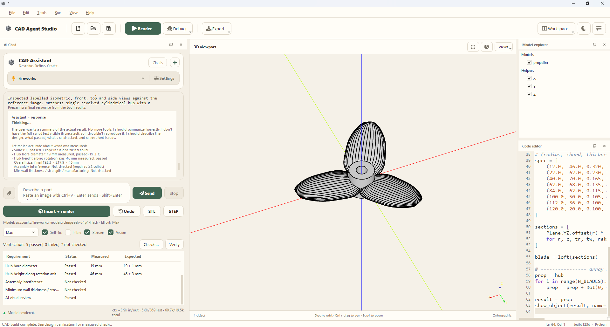
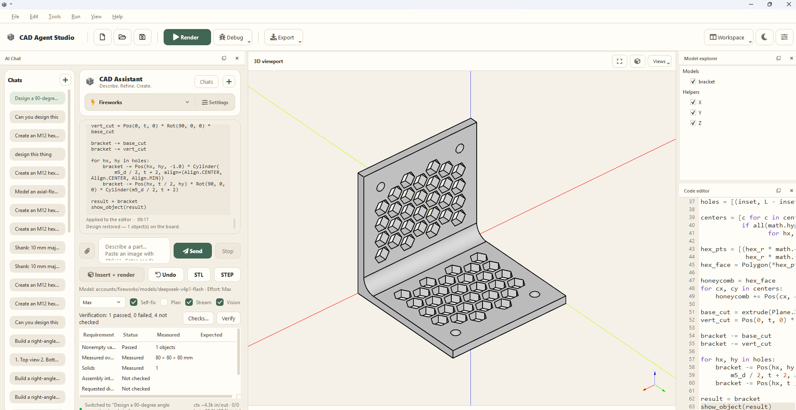
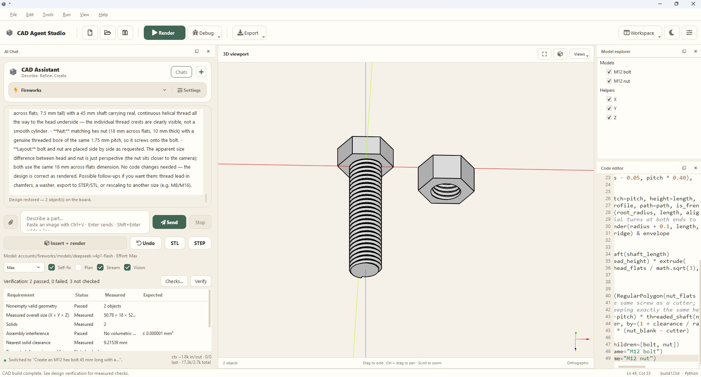
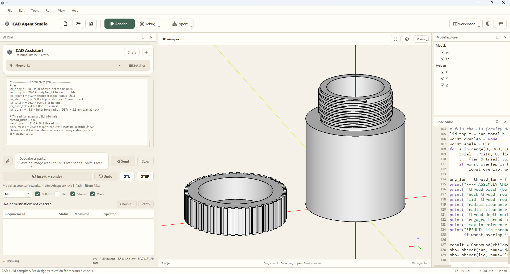

# CAD Agent Studio

**Describe a part, build it with Python, inspect the geometry, and export your model.**

CAD Agent Studio is a desktop CAD workspace powered by [build123d](https://github.com/gumyr/build123d),
PyQt5, and Open CASCADE. Write parametric Python models yourself or use the optional
AI assistant to turn a description or reference image into editable CAD code.
The editor, viewer, and manual modeling workflow work without an AI account.

This project is a fork of [CadQuery/CQ-editor](https://github.com/CadQuery/CQ-editor).
The application is branded **CAD Agent Studio**; the repository name, Python
package (`cq_editor`), and launch command (`cq-editor`) retain their existing names.



*The workspace supports dockable panels, editable model code, AI chat, and measured
checks. Panels in these screenshots have been rearranged from the default layout.*

## Contents

- [What you can do](#what-you-can-do)
- [Install and launch](#install-and-launch)
- [Create your first model](#create-your-first-model)
- [Configure an AI provider](#configure-an-ai-provider)
- [Design with the AI assistant](#design-with-the-ai-assistant)
- [Verify a design](#verify-a-design)
- [Save and export](#save-and-export)
- [CAD skills and automatic learning](#cad-skills-and-automatic-learning)
- [Chat commands and shortcuts](#chat-commands-and-shortcuts)
- [Troubleshooting](#troubleshooting)
- [Data, credentials, and execution](#data-credentials-and-execution)
- [Development and project layout](#development-and-project-layout)
- [Credits and license](#credits-and-license)

## What you can do

- Create parametric parts and assemblies with build123d Python scripts.
- Generate and refine designs from written requirements or reference images.
- Inspect models in an interactive 3D viewport with standard camera views.
- Edit code with syntax highlighting and completion; debug with variable inspection,
  tracebacks, and an embedded Python console.
- Use Fireworks, Featherless, Anthropic, or compatible custom API providers.
- Paste images with **Ctrl+V**, attach files, and enable AI visual feedback.
- Measure dimensions, cylindrical bores, solid counts, clearance, and interference.
- Save conversations and restore their design code across app restarts.
- Read bundled CAD skills and optionally learn reusable methods from successful work.
- Export **STEP** and **STL** through the interface; use the AI export tool for
  **BREP** as well.
- Choose light or dark themes, float or hide panels, and restore the workspace layout.
- Run normal renders, verification, and checked exports in cancellable child
  processes to keep the interface responsive.

### Example designs

The screenshots below were supplied from the application. They illustrate the
modeling workflow; a rendered model still needs its requirements and checks reviewed.

**Honeycomb angle bracket** — a bent bracket with patterned cutouts and mounting holes.



**Threaded bolt and nut** — separate objects with visible helical threads.



**Threaded jar and lid** — a hollow container and a separate knurled lid.



## Install and launch

### Requirements

You need Git, Python, and a desktop environment with working OpenGL support.
The source declares Python `>=3.10,<=3.14`; dependency wheels must also be available
for your Python version and operating system. Recent local checks used **Python
3.14.0**, **build123d 0.13.0**, and **PyQt5 5.15.11** on Windows. This is a tested
configuration, not a requirement to use those exact package versions.

The commands below use Python 3.12 as an example. Substitute your installed,
compatible version, such as `py -3.14` on Windows. Windows is the primary local
test environment; Linux and macOS support is inherited and has not been verified
on every system. There is no hosted web app required to run the editor.

### Windows: PowerShell

```powershell
git clone https://github.com/Syeed-MD-Talha/cq-build123d-editor.git
cd cq-build123d-editor
py -3.12 -m venv .venv
.\.venv\Scripts\Activate.ps1
python -m pip install --upgrade pip
python -m pip install -e ".[ai]"
python run.py
```

If PowerShell blocks activation, use the environment's executable directly:

```powershell
.\.venv\Scripts\python.exe -m pip install --upgrade pip
.\.venv\Scripts\python.exe -m pip install -e ".[ai]"
.\.venv\Scripts\python.exe run.py
```

### Linux / macOS

```bash
git clone https://github.com/Syeed-MD-Talha/cq-build123d-editor.git
cd cq-build123d-editor
python3.12 -m venv .venv
source .venv/bin/activate
python -m pip install --upgrade pip
python -m pip install -e ".[ai]"
python run.py
```

For the editor and viewer without the optional AI dependencies, install with
`python -m pip install -e .` instead. No API key is needed for manual modeling.

After installation you can also launch with `cq-editor`. To open an example directly:

```bash
python run.py examples/01_hello_box.py
```

## Create your first model

1. Start the app and open a new file, or choose **File > Examples**.
2. Paste the script below into the code editor.
3. Click **Render** or press **F5**.
4. Inspect the part in the viewport, then save the Python script with **Ctrl+S**.

```python
from build123d import *

# Dimensions are in millimetres.
result = Box(30, 20, 10)
result = fillet(result.edges().filter_by(Axis.Z), radius=2)
show_object(result, name="Rounded block")
```

`show_object` is supplied by the editor at execution time. A script using it needs
a separate display helper when run as a standalone Python program.
For assemblies, give each displayed part a useful name, for example
`show_object(jar, name="jar")` and `show_object(lid, name="lid")`. These names can
also be used to scope verification checks.

### Find your way around

| Area or control | Use |
| --- | --- |
| Code editor | Write or revise the Python model; save the source as `.py`. |
| 3D viewport | Drag to orbit, Ctrl+drag to pan, and scroll to zoom. Use Fit, the cube button, or **Views** for camera controls. |
| Model explorer | Show/hide named objects and select parts for inspection or export. |
| AI Chat | Send design requests, attach references, review tool results, and manage conversations. |
| Workspace | Show hidden panels or choose **Reset panel layout**. Panels can also float. |
| Theme button | Switch between light and dark appearances. Models use a neutral grey by default. |
| Debug | Start interactive debugging, step through code, or stop a normal CAD build. |
| Preferences | Configure the editor, viewer, AI limits, learning, and build timeout. |

Nine bundled [examples](examples/) cover boxes, selectors and fillets, extrusions,
holes, lofts, sweeps, a pillow block, assemblies, and a threaded bolt/nut. They are
project examples, not files automatically created for every AI request. Use
**Save As** to save your changes outside the bundled examples directory.

## Configure an AI provider

### Option 1: use the settings dialog

1. Open **AI Chat** from **Workspace** if the panel is hidden.
2. Choose a provider from the dropdown, then click **Settings**.
3. Enter its **API key**.
4. Click **Refresh** to load available models, or type a model ID yourself.
5. Expand **Advanced settings** if you need to enter or change the API base URL.
6. Click **Save settings**, then send a request.

| Profile | API style | Base URL behavior |
| --- | --- | --- |
| Fireworks | OpenAI-compatible Chat Completions | A default endpoint is supplied. |
| Featherless | OpenAI-compatible Chat Completions | A default endpoint is supplied. |
| Anthropic (Claude) | Anthropic Messages | A default endpoint is supplied. |
| Custom OpenAI-compatible | Chat Completions | Enter your service's base URL, normally ending in `/v1`. |
| Custom Anthropic-compatible | Anthropic Messages | Enter your service's Messages-compatible base URL. |

Choose a model with **function/tool calling** for the full CAD workflow and
**image input support** for reference images or Vision. Provider availability and
capabilities vary. The model visible in a screenshot is an example of a configured
profile, not a guarantee of access or image support. Refreshing a model list does
not guarantee that every listed model supports CAD tools or images.

### Option 2: use a local `.env`

Copy the blank template, then fill in the provider you want:

```powershell
# Windows PowerShell
Copy-Item .env.example .env
```

```bash
# Linux / macOS
cp .env.example .env
```

| Variable | Purpose |
| --- | --- |
| `CQ_AI_PROVIDER` | Initial profile: `fireworks`, `featherless`, `anthropic`, `custom_openai`, or `custom_anthropic`. |
| `FIREWORKS_API_KEY`, `FIREWORKS_MODEL_ID`, `FIREWORKS_BASE_URL` | Fireworks credentials and endpoint. |
| `FEATHERLESS_API_KEY`, `FEATHERLESS_MODEL_ID`, `FEATHERLESS_BASE_URL` | Featherless credentials and endpoint. |
| `ANTHROPIC_API_KEY`, `MODEL_ID`, `ANTHROPIC_BASE_URL` | Direct Anthropic profile. |
| `OPENAI_API_KEY`, `OPENAI_MODEL_ID`, `OPENAI_API_BASE` | Custom OpenAI-compatible profile. |
| `CUSTOM_ANTHROPIC_API_KEY`, `CUSTOM_ANTHROPIC_MODEL_ID`, `CUSTOM_ANTHROPIC_BASE_URL` | Custom Anthropic-compatible profile. |
| `CQ_SUBAGENT_MODEL_ID` | Optional model override for focused AI subagent tasks. |

Only the template belongs in Git. Real `.env` files are ignored.
The app checks the repository/package root and working directory for `.env`, then
uses dotenv's fallback search. Existing process environment variables take
precedence over `.env`; saved profile fields in the settings dialog override their
environment defaults. Restart after changing environment-based configuration.

## Design with the AI assistant

### Start with clear requirements

Give dimensions, units, part names, and intended features. For example:

> Create an 80 × 80 × 80 mm right-angle bracket with 3 mm walls, rounded inside
> bend, four 5.5 mm mounting holes, and hexagonal ventilation cutouts. Keep the
> mounting holes clear of the cutouts. Make the bracket one continuous solid.

Then refine the same conversation:

> Increase the wall thickness to 4 mm, keep the outside dimensions, and add
> 1 mm fillets to exposed edges.

The assistant can inspect editor code, read examples and skills, record measurable
requirements, build and validate code, render it, review views, and export models.
By default, generated code can be applied automatically. Review both the script
and the verification table before relying on the result.

### Use a reference image

1. Copy an image or take a screenshot.
2. Click the chat input and press **Ctrl+V**, or click the paperclip to choose files.
3. Check the attachment preview. Remove unwanted images before sending.
4. Add known dimensions and explain which features matter, then click **Send**.

Up to **three reference images per message** can be attached. Each is resized to
at most **1024 pixels on its longest side** and encoded as JPEG for the request.
One pasted image adds one reference attachment. A photo alone does not establish
accurate scale; supply at least one known dimension.

The **Vision** toggle controls automatic viewport feedback after rendering. When
available, it sends **four additional labelled views**: isometric, front, top, and
side. It does not control whether an image you explicitly attached is sent.
A turn may involve multiple requests and renders, and earlier images can remain in
conversation context, so the attachment count is not a total session image budget.

### Understand the chat controls

| Control | Behavior |
| --- | --- |
| Send / Enter | Send the current prompt and pending attachments. Shift+Enter inserts a new line. |
| Stop | Cancel the active AI/CAD operation and ignore late replies. |
| Self-fix | Allow automatic repair after failed tools or code. Successful tool sequences continue even when it is off. |
| Plan | Validate proposed code without automatically applying it. Review and use **Insert + render** when ready. Skill writes are disabled in this mode. |
| Stream | Display the response as it arrives. Unsupported streaming can fall back to a complete reply. |
| Vision | Send viewport views after successful renders for a separate AI visual review. |
| Low / Medium / High / Max | Adjust output/reasoning budgets. Higher effort can take longer; support depends on the model and API. |
| Insert + render | Apply the available generated script to the editor and build it. |
| Undo | Restore editor code from the previous apply checkpoint. |
| Chats / + | Show saved conversations or start a new one. Switching chats can restore that chat's saved design. |
| Checks... / Verify | Edit measurable requirements and check the current editor code locally. |
| STL / STEP | Export the current rendered models through a save dialog. |

Under **Preferences > AI Chat**, **Auto-apply code** controls automatic insertion,
**Max tool iterations** limits tool rounds (default 6), and **Pre-render timeout
(s)** sets the CAD time budget (default 180 seconds). **Learn reusable CAD skills**
is enabled by default. Skill learning and recovery use the available tool budget;
a difficult design may need a simpler request or a larger limit.

At the tool limit, the app makes one final request without tools for a complete
script or a completion status. If that request fails, the error remains visible.
Temporary provider/network failures get up to two retries with backoff; partial
stream replies and incomplete tool arguments are discarded before recovery.
Retries do not guarantee that an unavailable provider will recover.

## Verify a design

1. Open **Checks...** and compare the assistant's requirements with your request.
2. Set the expected values and tolerances, in millimetres where applicable.
3. Use **Part** to select a displayed object name, such as `jar`, or use `all` for
   an assembly-wide check. Name both parts for a clearance/interference check.
4. Click **Verify** to build and inspect the current editor code locally.
5. Read the measured values and every failed or unchecked row before exporting.

| Status | Meaning |
| --- | --- |
| Passed | A supported check met its recorded requirement. |
| Failed | A measured result did not meet the recorded requirement. |
| Measured | A value is reported without a pass/fail requirement. |
| Not checked | The check was unavailable, unsupported, skipped, or could not be completed. |

Checks measure the resulting geometry rather than trusting Python parameter
variables. Supported checks include overall dimensions, object/solid counts,
cylindrical bore diameters/counts, named-part clearance, and overlap volume.
Failed checks can feed the repair loop. The AI cannot weaken recorded requirements
during the same request, but its initial interpretation can still miss details.

Important limits:

- Bore checks detect inward cylindrical surfaces, not thread profiles or
  conical/irregular holes. Counterbore stages count separately.
- Automatic interference inspection covers assemblies up to 15 solids. Larger
  assemblies need explicit named-pair checks. Side-by-side parts must be moved
  into their intended assembled positions to meaningfully test assembled fit.
- A displayed object can contain multiple disconnected solids. Such objects are
  flagged for review; object count alone does not prove physical continuity.
- Wall thickness, strength, manufacturing suitability, and unsupported features
  remain **Not checked**. There is no automatic FEA or manufacturing certification.
- AI visual review is separate from measured verification. Capturing images alone
  does not count as a passed visual review, and visual approval is not metrology.
- A verifier error preserves a completed model for review and reports the affected
  checks as **Not checked**. It does not prove those checks passed.

A check's tooltip shows its measured scope. Older checks with a blank part can be
scoped by an exact, unambiguous displayed object name in their text. The viewport
camera is restored after automatic multi-view capture.

## Save and export

**Save the source:** use **Ctrl+S** or **File > Save As** to keep the parametric
Python script. Saving a script and exporting CAD geometry are separate actions.

**Export geometry:** render first. Use the AI Chat **STL**/**STEP** buttons to
export the current models, or select objects in the Model explorer and use
**Export** or its context menu. The assistant's `export_model` tool also supports
BREP. AI tool exports without an explicit filename default to `exports/model.ext`
under the working directory.

| Format | Typical use |
| --- | --- |
| STEP | Exchange solid CAD geometry with other CAD software. |
| STL | Triangular mesh for slicers, printing workflows, and mesh tools. |
| BREP | Preserve Open CASCADE boundary-representation geometry. |
| Python (`.py`) | Keep editable modeling parameters and construction history in code. |

Checked exports run in a child process and reopen the actual exported file.
Checks compare bounds, STEP/BREP solid counts and volume, and STL mesh closure,
edge orientation, and connectivity. STL checks have a 256 MB / 500,000-triangle
budget and do not test self-intersections; skipped checks stay visible.

**Save a conversation:** chats are stored locally automatically. Use `/export`
to save a Markdown transcript; that command exports chat text, not CAD geometry.
The model upload dialog sends a selected model/script to its chosen URL and
includes a PCBWay preset plus a custom URL option.

## CAD skills and automatic learning

The assistant has four bundled skills:

| Skill | Reusable guidance |
| --- | --- |
| `threaded-fasteners` | Threaded bolts, matching nuts, and robust helical geometry. |
| `lofts-and-sweeps` | Section-based shapes, lofts, and swept profiles. |
| `assemblies` | Named components, positioning, and compound models. |
| `geometry-repair` | Common modeling failures and repair strategies. |

The assistant initially sees a short skill index and loads full instructions only
when needed. It can read bundled example code or a learned skill's `example.py`.
Skills supplement your dimensions and requirements; they do not replace checks.

**Can the app create its own skills?** Yes. With **Preferences > AI Chat > Learn
reusable CAD skills** enabled, the assistant can save a method from a successful
design or repair as a draft. It can then request activation. The app checks the
content and builds the included example in an isolated process before adding it
to the active skill index. This is optional and does not happen after every model.

- Drafts live in `~/.cq-editor/skills/drafts/`; active skills live in `active/`.
- Failed revisions remain drafts and do not replace an existing active version.
- Changes to an active skill need validation and activation again.
- The assistant cannot overwrite bundled skills.
- Disable learning to prevent skill writes while keeping existing skills readable.
- Plan mode disables skill writes too. Skills persist across chats and restarts.

Use `/skills`, `/skills threaded-fasteners`, or `/skills name draft` to inspect
skills locally without an API request. Content checks reject obvious credentials,
instruction overrides, unsupported imports, and file/network operations in learned
examples. These checks are not a security sandbox. Successful activation only
shows that the included example built valid geometry; other uses need verification.

## Chat commands and shortcuts

Type `/` in the chat input to see command suggestions.

| Command | Action |
| --- | --- |
| `/help` | List commands. |
| `/new` or `/clear` | Start a new conversation. |
| `/status` | Show the selected profile, model, effort, mode, and context estimate. |
| `/model` | Show model information; change it in Settings. |
| `/effort` or `/effort high` | Show effort budgets or select low, medium, high, or max. |
| `/plan` | Toggle validation-only Plan mode. |
| `/undo` | Restore the previous code checkpoint. |
| `/usage` | Show recorded input/output token totals for the chat. |
| `/compact` | Report automatic context compaction; compaction already runs before requests. |
| `/examples` | List bundled examples. |
| `/skills` | List active skills and drafts; add a name to inspect one. |
| `/export` | Save a Markdown chat transcript. |

| Shortcut | Action |
| --- | --- |
| Ctrl+N / Ctrl+O | New / open Python script. |
| Ctrl+S / Ctrl+Shift+S | Save / Save As. |
| F5 | Render the current script. |
| Ctrl+F5 | Toggle interactive debugging. |
| Ctrl+F10 / Ctrl+F11 / Ctrl+F12 | Step / step in / continue while debugging. |
| Enter / Shift+Enter in chat | Send / new line. |
| Ctrl+V in chat | Paste text or attach a clipboard image. |

## Troubleshooting

| Symptom | What to do |
| --- | --- |
| `ChunkedEncodingError: Response ended prematurely` | The response download was interrupted. The app discards the partial reply and retries up to twice. If it persists, retry later, check your network/proxy, or try with Stream off. Turning Stream off cannot prevent every connection failure. |
| `validate_cad_code` reports empty code | The model supplied missing/empty arguments. The app requests a complete script once and never executes empty code. If repeated, simplify the request or use a model with reliable tool calling. |
| Response is truncated | Text continuation is bounded to two attempts; partial tool arguments are regenerated. Try a smaller design request or lower reasoning effort if output is exhausted. |
| `Tools executed (self-fix off or limit reached)` | Review the last failed tool and verification table. Enable Self-fix for repair attempts, or raise Max tool iterations if the task needs more rounds. |
| Invalid key, HTTP 401/403, quota, or missing model | Correct the selected provider's key, access, billing, model ID, or base URL. The app does not silently switch providers. |
| Model does not support images | Choose an image-capable model. Disabling Vision stops automatic views; also remove explicit image attachments when using a text-only model. Start a new chat if old image context is rejected. |
| Build takes too long | Click Stop for AI work or **Debug > Stop CAD build** for a manual render. Simplify expensive booleans/threads, or adjust Pre-render timeout (s). |
| Two canceled requests are still disconnecting | Wait for their bounded network timeouts before starting another request. Late replies are ignored. |
| Verification shows Not checked | Read the row detail/tooltip. Unsupported checks need manual inspection or a separate engineering tool; they are not passed checks. |
| No objects appear | Confirm the script builds a nonempty shape and calls `show_object(...)`; check object visibility, use Fit, and read the traceback/activity log. |
| Panels disappeared | Open Workspace and re-enable them, or choose Reset panel layout. |
| Missing module / `cq-editor` not found | Use the same virtual environment for installation and launch. Run `python -m pip install -e ".[ai]"`, then `python run.py`. |
| Blank viewport or OpenGL error | Check desktop/graphics support and drivers. Headless systems need a suitable display setup; offscreen Qt alone does not guarantee an OCCT viewport. |

Normal Render/F5, AI builds, verification, and checked exports use cancellable CAD
child processes. Interactive debugger steps and console commands still execute in
process, so a long native geometry operation there can block the interface.
Normal isolated renders restore displayed shapes and simple scalar variables to
the console; arbitrary Python objects and functions remain in the child process.

For a bug report, include your OS, Python/build123d versions, installation method,
traceback, and a minimal script or reproducible prompt. Remove private designs and
credentials before posting to [this repository's issues](https://github.com/Syeed-MD-Talha/cq-build123d-editor/issues).

## Data, credentials, and execution

| Data | Location / handling |
| --- | --- |
| API profiles | Stored locally through Qt application settings; keys are not encrypted. |
| Environment credentials | Local `.env` or process environment; `.env` is ignored by Git. |
| Conversations and saved designs | `~/.cq-editor/chat_sessions/`, or `%USERPROFILE%\.cq-editor\chat_sessions\` on Windows. |
| Learned skills | `~/.cq-editor/skills/`, outside the repository. |
| Default AI geometry exports | `exports/` in the working directory; ignored by Git. |
| README screenshots | Selected, intentionally published images in `docs/images/`. |

AI requests send your prompts, relevant code, tool results, explicit attachments,
loaded skill instructions, and enabled viewport feedback to the selected provider.
API usage may incur provider charges. Context estimates are approximate; `/usage`
shows the usage recorded by the app rather than a billing statement.

Generated code runs locally with your user's permissions. A child process provides
crash isolation and cancellation, not an operating-system security sandbox. Review
code and use providers/scripts you trust. API keys are excluded from chat exports
by design, but do not paste secrets into prompts, scripts, or screenshots. Local
profile settings are unencrypted, so protect your operating-system account.

## Development and project layout

```text
cq_editor/
  ai/              Provider clients, CAD tools/runtime, recovery, skills, verification
  widgets/         Editor, AI chat, job controls, model explorer, viewport, dialogs
  main_window.py   Menus, toolbar, layout, and component wiring
  theme.py         Shared light/dark palettes
examples/          Nine build123d example scripts
docs/images/       Screenshots used by this README
tests/             Geometry, provider, recovery, skill, verification, and Qt tests
icons/             Application logo and view assets
pyinstaller/       Packaging assets and runtime hooks
conda/             Conda packaging/installer configuration
run.py             Source launch entry point
pyproject.toml     Dependencies, optional extras, and command entry points
pyinstaller.spec   PyInstaller build definition
.env.example       Blank provider configuration template
```

Install development dependencies in your environment:

```bash
python -m pip install -e ".[ai,test,dev]"
python -m pytest
```

For the focused CAD/AI and workspace regression tests on Windows PowerShell:

```powershell
$env:QT_QPA_PLATFORM = "offscreen"
python -m pytest tests/test_ai_providers.py tests/test_ai_recovery.py tests/test_ai_skills.py tests/test_cad_generation.py tests/test_verification.py tests/test_workspace_ui.py -q
```

The focused workspace tests suppress native painting. Full viewer tests need a
real desktop/display and working OpenGL; a passing offscreen suite does not test
hardware rendering. Linux CI uses Xvfb and software rendering; see the
[Linux test workflow](.github/workflows/test_linux.yml). Tests inject fake provider
responses rather than requiring your API key for recovery scenarios.

Check formatting with the CI command:

```bash
black --diff --check . --extend-exclude "(icons_res.py|examples/|[.]pytest_cache/)"
```

Packaging starts from `pyinstaller.spec`. The Conda recipes, constructor workflow,
and Azure pipeline were inherited from upstream and contain upstream publishing
settings; review them before using them for your own releases.

## Credits and license

CAD Agent Studio builds on the work of the CadQuery/CQ-editor community and uses
build123d for its modeling engine. Existing upstream attribution is retained.

- [CQ-editor source](https://github.com/CadQuery/CQ-editor)
- [CQ-editor wiki](https://github.com/CadQuery/CQ-editor/wiki) for inherited UI concepts
- [build123d documentation](https://build123d.readthedocs.io/)
- [Apache License 2.0](LICENSE)
